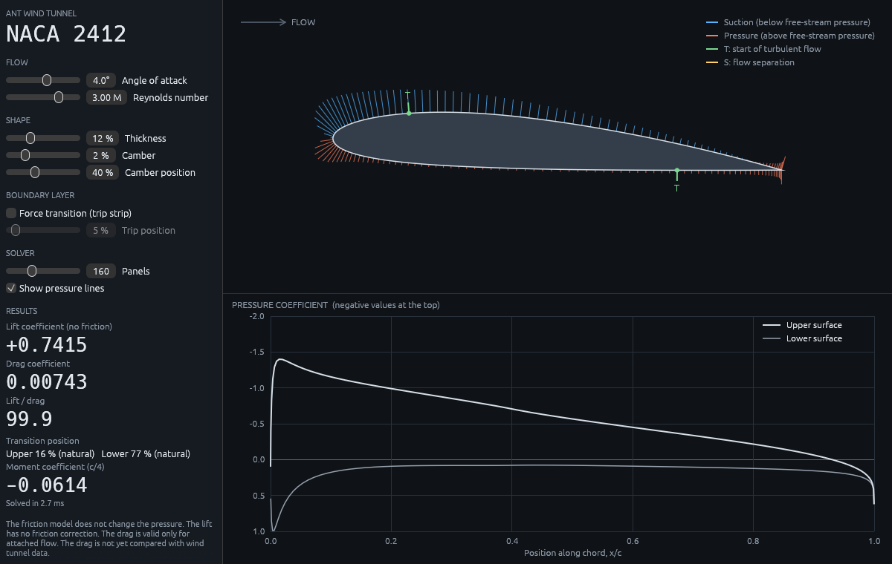

# ant-wind-tunnel-sim

A desktop program, written in Rust, to design and analyze airfoils.

- Goals and stages: [GOALS.md](GOALS.md)
- Sources: [REFERENCES.md](REFERENCES.md)

## Status



- Stage 1 is complete: an inviscid (no friction) panel method for NACA 4-digit
  airfoils, with validation tests against exact theory.
- Stage 2 is complete: a desktop window with an airfoil view, a pressure
  plot, and live controls.

- Stage 3a is complete: a one-way boundary layer calculation that gives
  friction drag, transition positions, and a flow separation warning.

The friction model does not change the pressure. The lift has no friction
correction and the program does not predict stall. The drag is valid only
for attached flow. For the NACA 0012 at a Reynolds number of 6 million, the
drag is within 6% of wind tunnel data at low lift. See [GOALS.md](GOALS.md)
for the full validation table.

## Use

Install Rust from https://rustup.rs, then:

```
cargo run --release -p ant-wind-tunnel          # start the desktop program
cargo test                                      # validation tests
cargo run --release --example polar -- 2412     # results table for NACA 2412
```

## License

MIT. See [LICENSE](LICENSE).
